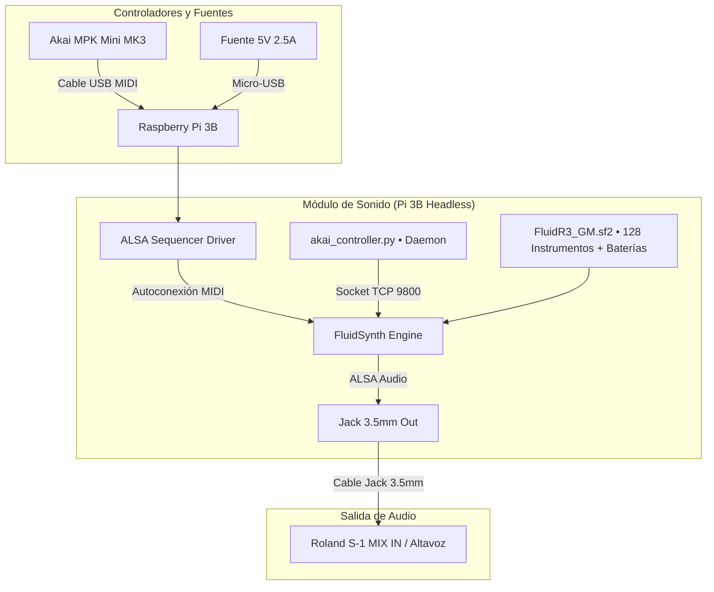

# Sintetizador Autónomo Raspberry Pi 3B + Akai MPK Mini MK3 (FluidSynth Standalone)

> 🌐 **Live Web Waveform Visualizer (Roland S-1 & Synths):** [https://carrommad.github.io/midi-to-synth/](https://carrommad.github.io/midi-to-synth/)

Convierte tu **Raspberry Pi 3 Model B (v1.2)** en una estación de sonido y ritmos independiente, con arranque automático sin monitor ni ratón (*zero-screen*), controlada al 100% desde el teclado, perillas y pads del **Akai MPK Mini MK3** (compatible también con MK2).

---

## Especificaciones del Hardware & Sistema

| Componente | Detalle Verificado |
|---|---|
| **Placa** | Raspberry Pi 3 Model B Rev 1.2 (Quad-Core Cortex-A53 @ 1.2 GHz, 1 GB RAM) |
| **Sistema Operativo** | **Raspberry Pi OS (Debian GNU/Linux 13 "Trixie")** |
| **Arquitectura** | **64-bit (`arm64` / `aarch64`)** |
| **Kernel** | `Linux 6.12.75+rpt-rpi-v8 #1 SMP PREEMPT` |
| **Controlador MIDI** | **Akai MPK Mini MK3 / MK2** (USB Class-Compliant) |
| **Motor de Sonido** | **FluidSynth** (ALSA Audio, baja latencia, procesador de efectos reverb y chorus activos) |
| **Salida de Audio** | Salida Jack 3.5mm estéreo hacia Roland S-1 (MIX IN) / Auriculares / Altavoces |

---

## Arquitectura del Sistema



---

## Manual de Instrucciones en PDF (2 Páginas A4)

Puedes consultar o imprimir el manual visual maquetado con esquemas vectoriales de las teclas y atajos:
* 📄 **[Manual de Instrucciones Akai MPK Mini (PDF)](docs/Manual_Instrucciones_Akai_MPK_Mini.pdf)**
* 🌐 **[Código fuente del manual (HTML)](docs/manual_akai_mpk.html)**
* 📋 **[Mapeo técnico detallado (Markdown)](docs/MIDI_MAPPING_AKAI.md)**

<p align="center">
  
  
</p>

---

## Guía Rápida de Operación en Vivo

### 1. Los 4 Modificadores Sin Pantalla (Extremo Izquierdo)
Las 4 primeras teclas del extremo izquierdo del teclado actúan como selectores ergonómicos:
* **`C1` (1ª Blanca) + Teclas (3 a 25)**: Cambia entre **24 Instrumentos Melódicos** (Pianos acústicos, Rhodes, DX7, Órgano Hammond B3, Guitarras, Bajos 808/303, Cuerdas y Sintetizadores) con preview sonoro en celesta.
* **`C#1` (1ª Negra) + Teclas (3 a 25)**: Cambia entre **24 Kits de Batería** (Standard, Room Rock, Heavy Gated, Roland TR-808 Trap, Jazz, Escobillas, Orquestal...) con preview en bombo/caja.
* **`D1` (2ª Blanca) + Pads (1 a 8)**: Control completo del **LIVE BEAT LOOPER**:
  - `Pad 1`: Armar metrónomo / Cerrar loop con redondeo inteligente / Grabar Overdub en capas 2, 3 y 4.
  - `Pad 2`: Pausar o reanudar el bucle.
  - `Pad 3`: Metrónomo click On / Off.
  - `Pad 4`: Borrar todas las pistas (Reset).
  - `Pads 5, 6, 7 y 8`: **Control de Capas 1 a 4** (Toque corto: Silenciar/Mute toggle con chime grave/agudo; Sostener > 1.0s: Borrado individual de esa capa).
* **`D#1` (2ª Negra) + Pads (1 a 8)**: **8 Ritmos Pregrabados** listos para improvisar (1: Lo-Fi 76 BPM, 2: Boom-Bap 88 BPM, 3: Trap 808 138 BPM, 4: Deep House 124 BPM, 5: Rock 104 BPM, 6: Funk 94 BPM, 7: Jazz 118 BPM, 8: Afrobeat 108 BPM).
  - **Auto-Sync BPM con Arpegiador**: Si tocas notas con el arpegiador activo antes de pulsar el pad, el ritmo arranca de inmediato sincronizado al tempo exacto mostrado en la pantalla OLED del Akai (o el fijado para tu Roland S-1). Gira **`K3`** para afinar o alterar la velocidad en directo.

---

### 2. Atajos Globales de Teclado
* **`C1` + `C#1` (Pulsar a la vez)**: Alterna el modo **FULL LEVEL** del teclado (100% fuerza fija en todas las notas vs curva dinámica táctil).
* **`C1` + `C3` (Sostener 3 segundos)**: **Apagado Seguro** de la Raspberry Pi. Silencia de inmediato las notas extremas, avisa con un sutil chime y reproduce un arpegio descendente de despedida (el inverso exacto de la melodía de arranque) antes de apagar el sistema para proteger la tarjeta microSD.
* **Joystick 4 direcciones**:
  - *Horizontal*: Pitch Bend suave (&plusmn;2 semitonos).
  - *Vertical*: Modulación / Vibrato expresivo.

---

### 3. Matriz Simétrica 4x2 de los 8 Knobs
* **Fila Superior (Batería y Looper)**:
  - `K1`: **Drum Reverb Splash** (CC 91 caja y platos).
  - `K2`: **Drum Pitch Tuning** (Afinación &plusmn;12 semitonos).
  - `K3`: **Looper Tempo** (Control de velocidad en vivo de 30 a 210 BPM).
  - `K4`: **Drum Volume** (Volumen de batería y pads en CC 7 Ch 10).
* **Fila Inferior (Teclado y Master)**:
  - `K5`: **Keys Reverb Eco** (Reverberación catedral en teclado).
  - `K6`: **Keys Chorus Lush** (Grosor vintage Roland Juno).
  - `K7`: **Decay Envelope / Reverb Bloom** (Control inteligente dual: 3s a 30s de caída para instrumentos continuos como trompeta, órganos, cuerdas y sintes; o reverb catedral expansiva para pianos y guitarras).
  - `K8`: **Master Volume** (Volumen general de todo el sistema).

---

### 4. Modo CC en los Pads (Botón físico 'CC' activo)
* `Pad 1`: **Pedal de Sustain** (Toggle para mantener notas flotando sin pedal de pie).
* `Pad 2`: **Portamento / Glide** (Deslizamiento fluido de tono entre notas ligadas).
* `Pad 3`: **Cutoff Boost** (Apertura de filtro y brillo al 100%).
* `Pad 4`: **Reverb Kill** (Corte momentáneo de reverb mientras se pulsa).
* `Pad 5`: **Chorus Splash** (Explosión de chorus espacial mientras se pulsa).
* `Pad 6`: **Instrumento Anterior** (con preview sonoro).
* `Pad 7`: **Instrumento Siguiente** (con preview sonoro).
* `Pad 8`: **¡Pánico / Stop Total!** (silencia cualquier nota o bucle colgado).

---

## Roland S-1 Waveform Lab (Analizador Web de Audio en Tiempo Real)

El repositorio incluye un laboratorio visualizador de audio en tiempo real diseñado específicamente para sintetizadores analógicos/virtuales como el **Roland S-1 Tweak Synth** (compatible con audio USB-C class-compliant o entrada de línea/jack).

* 🌐 **Acceso Web en Vivo (GitHub Pages):** [https://carrommad.github.io/midi-to-synth/](https://carrommad.github.io/midi-to-synth/)
* 🚀 **Ejecución local rápida:** `./visualization/run.sh`

<p align="center">
  <a href="https://carrommad.github.io/midi-to-synth/">
    
  </a>
</p>

### Características de Gráficos e Instrumentación
1. **Osciloscopio (Dominio Temporal):** Sincronización robusta por cruce por cero (*Sync Lock*), auto-ganancia suave con umbral antirruido y control manual de V-Gain / Zoom.
2. **Espectro FFT & Tracker de Resonancia:** Escala logarítmica (20 Hz a Nyquist), detección automática de frecuencia de corte VCF / pico armónico con rechazo de zumbido eléctrico (< 80 Hz).
3. **Cascada 3D Waterfall (Tiempo × Frecuencia):** Proyección isométrica tridimensional con 180 líneas de persistencia, escala logarítmica y navegación interactiva (Órbita, Desplazamiento y Zoom).
4. **Serie Armónica Discreta (1f₀ - 16f₀):** Desglose individual de sobretonos pares e impares con memoria de tono y decaimiento visual suave.
5. **Espectrograma Continuo de Calor:** Cascada temporal vertical con auto-escalado AGC dinámico.
6. **Dial de Cromagrama & Goniómetro Estéreo:** Rueda de clases de tono de 12 semitonos con umbral de silencio y osciloscopio de fase estéreo.
7. **Monitor de Altavoces & Medidor Broadcast:** Conmutador directo de altavoz portátil y vúmetro calibrado con indicador persistente de saturación (**CLIP**).

---

## Estructura del Repositorio

```text
midi-to-synth/
├── README.md                      # Esta guía central
├── docs/
│   ├── Manual_Instrucciones_Akai_MPK_Mini.pdf  # Manual imprimible de 2 páginas A4
│   ├── manual_akai_mpk.html                    # Fuente HTML del manual visual
│   ├── MIDI_MAPPING_AKAI.md                    # Mapeo y arquitectura técnica de notas
│   ├── ROLAND_S1_INTEGRATION.md                # Guía de integración con Roland S-1
│   ├── FASE_A_FLUIDSYNTH.md                    # Documentación de instalación base
│   └── OPTIMIZACION_LATENCIA.md                # Parámetros ALSA y buffers de baja latencia
├── scripts/
│   ├── akai_controller.py         # Daemon principal (Looper, modificadores, routing, apagado)
│   ├── start-synth.sh             # Script de arranque del servicio FluidSynth
│   ├── synth.service              # Unidad de servicio Systemd para boot headless
│   ├── install_fluidsynth.sh      # Script de aprovisionamiento de dependencias
│   └── select_sound.sh            # Utilidad CLI para selección por terminal
└── visualization/
    ├── index.html                 # Interfaz visual del Waveform Lab
    ├── styles.css                 # Sistema de diseño, temas dark y layout responsive
    ├── app.js                     # Motor Web Audio API (doble analizador FFT, algoritmos DSP)
    ├── favicon.svg                # Favicon estilizado Roland S-1
    └── run.sh                     # Lanzador de servidor local
```


---

---

## 🔒 Seguridad de Red y Control del Motor (Puerto 9800)

FluidSynth abre un shell interactivo de control en el puerto TCP `9800`. Para evitar accesos no autorizados desde la red local (Wi-Fi), el puerto está aislado a nivel de kernel mediante reglas persistentes de `iptables`:
- **Tráfico local (Loopback / `127.0.0.1`):** `ACCEPT` (usado por `start-synth.sh` y scripts internos de control).
- **Tráfico externo (Wi-Fi / LAN):** `DROP` (bloquea cualquier sondeo o comando entrante desde la red doméstica).
- **Persistencia:** Gestionado por `netfilter-persistent` (`/etc/iptables/rules.v4`).
